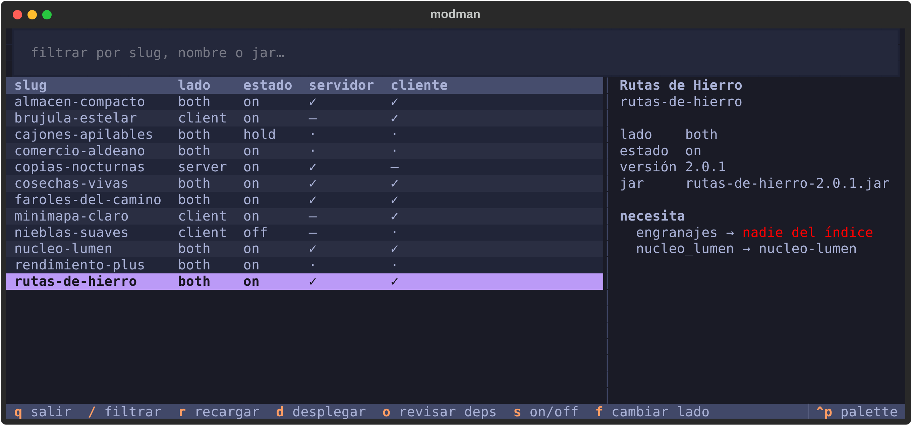
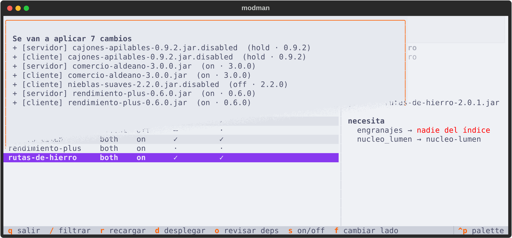
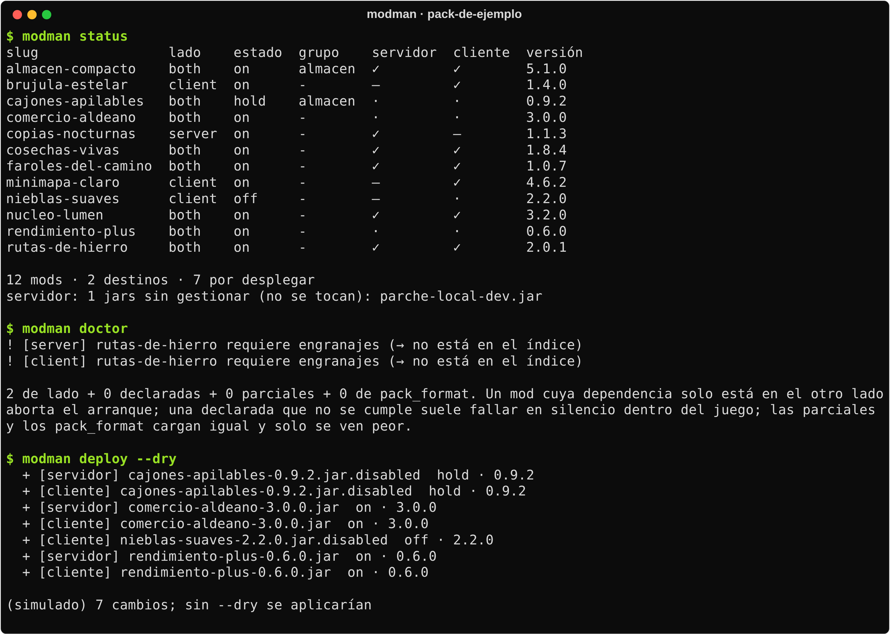

<div align="center">

# modman

**Los mods de un modpack de Minecraft, con cada decisión escrita en git.**


</div>

---

## Qué es

Un modpack en desarrollo no es una carpeta de jars: es un montón de decisiones que no están escritas
en ninguna parte. Por qué este mod está desactivado, en qué lado hace falta, cuál de los dos
duplicados se quedó, qué versión había antes de que algo se rompiera.

modman guarda la decisión al lado del dato. Cada mod es un TOML en git, con su lado, su estado, su
grupo de duplicados y **el motivo**. Los jars se deducen de ahí y se despliegan en uno o varios
destinos: el servidor, la instancia del launcher o las dos. Trae una CLI pensada para scripts y
agentes, y una TUI para revisarlo todo con calma.

<p align="center">
  
  &nbsp;
  
</p>
<p align="center">
  
</p>

<p align="center"><sub>Pack de ejemplo con mods inventados. Las capturas se regeneran con <code>tools/capturas/capturas.sh</code>.</sub></p>

## Funciones principales

- **Índice en git**: un TOML por mod con lado (`server`, `client`, `both`), estado (`on`, `off`,
  `hold`) y el motivo de cada decisión.
- **Varios destinos**: servidor, cliente o varias instancias. El lado de cada mod decide dónde
  aterriza, y los jars que no gestiona modman nunca se tocan.
- **Despliegue planificado**: `deploy --dry` enseña el plan y la TUI pide confirmación antes de
  escribir en las carpetas que lee el juego.
- **Dependencias por lado**: `doctor` avisa cuando un mod necesita algo que falta en su lado, que es
  lo que tumba un servidor al arrancar.
- **Lo que nadie declara**: shaders que exigen una versión exacta, paquetes de texturas que
  necesitan Continuity u otro mod parecido, y requisitos con varias combinaciones válidas.
- **Shaders contra su cargador**: comprueba las capacidades que exige cada shaderpack con las que
  implementa el Iris u Oculus instalado.
- **Modrinth y CurseForge** como fuentes, con verificación de hash y vuelta atrás de cada
  actualización.
- **Pensado para automatizar**: `modman --json help` describe cada comando, qué escribe y qué
  opciones admite.

## Tecnologías

| Capa | Tecnología |
|---|---|
| Núcleo y CLI | Python 3.11+, solo la biblioteca estándar |
| TUI | Textual y Rich (extra opcional `[tui]`) |
| Fuentes | API de Modrinth y de CurseForge |
| Pruebas | pytest, pytest-asyncio y el harness de Textual |
| Empaquetado | uv, hatchling |

## Puesta en marcha

```bash
uv tool install "modman[tui] @ git+https://github.com/noctivulp-ch/modman"
cd /ruta/a/mi-modpack
modman init           # escribe un modman.toml de partida
modman status
modman-tui
```

Para desarrollar:

```bash
uv run --extra dev pytest
```

## Documentación

El uso completo está en la [guía](docs/guia.md): las tres formas de gestionar un pack, los shaders
y paquetes de texturas, CurseForge y el ciclo de decisión con `catalog`. La arquitectura y las
decisiones (ADR) están en [`docs/`](docs/index.md). La skill de Claude Code que acompaña a la
herramienta está en [`skills/`](skills/README.md).

## Licencia

Código bajo **GPL-3.0-or-later** ([`LICENSE`](LICENSE)). Los componentes de terceros y sus licencias
están en [`NOTICE`](NOTICE). El nombre y la identidad visual no forman parte de la licencia: ver
[`TRADEMARKS.md`](TRADEMARKS.md). Para aportar, [`CONTRIBUTING.md`](CONTRIBUTING.md).

## Apoyo

Este proyecto forma parte del trabajo de **NoctiVulp**: herramientas para Linux y Android,
publicadas como software libre. Las compilaciones oficiales y las novedades salen en Patreon.

<p align="center">
  <a href="https://www.patreon.com/cw/NoctiVulp"></a>
</p>

---

<p align="center"><sub>© 2026 NoctiVulp · <b>Powered by AI</b> — desarrollado con la asistencia de Claude, de Anthropic.</sub></p>
